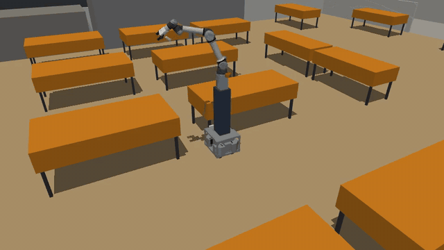
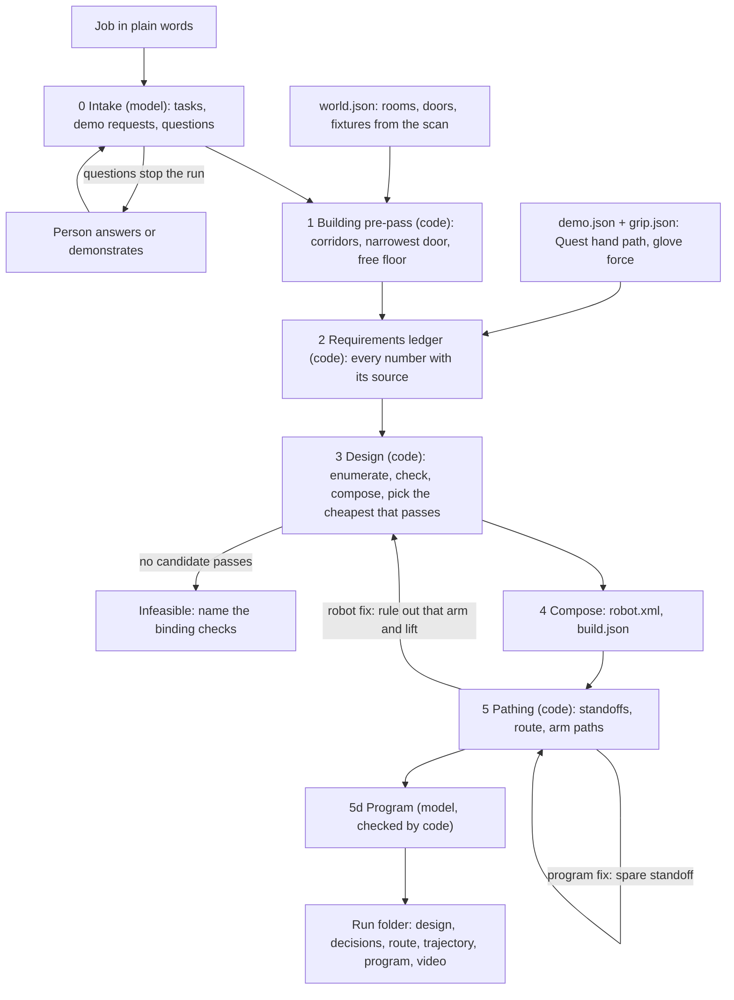

# Nothingburger

Agents that design a robot for a job in a real building.

You describe the job in plain words and demonstrate it once, wearing a Meta Quest headset and a pair of force-sensing gloves. Agents turn the building scan and the demonstration into requirements, assemble a robot from a catalog of real parts, pick the cheapest one that passes every check, and plan its route and arm motions through the building.

Every robot is built from the same modular parts, so it is repeatable to manufacture, but each is specialised to its job, so you pay only for the reach, payload and base that job needs.



The robot the agent designed for the Julis Romo Rabinowitz (JRR) Hall atrium, running its plan. Positions are played back; contact is not simulated. [Full video](docs/media/jrr-walkthrough.mp4) (4 min 42 s). The Devpost write-up is in [`DEVPOST.md`](DEVPOST.md).

## How it works



1. **The conversation.** A LangGraph workflow on Claude takes the job, names the skill, and asks for a demonstration when it has none. Questions it cannot settle from the building pause the run until a person answers.
2. **The demonstration.** The Quest tracks the head, wrists and finger joints at 30 Hz in the frame of the loaded scan. Two gloves, each with five fingertip force sensors on an ESP32, stream over Bluetooth and are laid onto the recording by time. Out come `demo.json` (the hand's path relative to the object, and the kind of motion) and `grip.json` (the grip force band).
3. **Design.** The building and the demonstration become a requirements ledger. Code enumerates the catalog (7,140 combinations), drops what fails on arithmetic, composes the rest as MuJoCo models cheapest first, and keeps the first that passes every check: doorway, turn, door header, steps, reach, tip-over, payload, opening, force, wrist roll.
4. **Pathing.** A parking spot is found for each task, the base route is planned with A*, and the demonstrated hand path is re-anchored onto the building's fixture and solved for the chosen arm. If the arm cannot do the work, that arm and lift are ruled out and design runs again, up to five times.
5. **Watching.** The run writes a walkthrough video, and for a world traced from a Matterport tour, the robot plays its plan inside the scan.

The model plans, asks and explains. Every pass or fail is code, and the model never overrides one. The full design is in [`docs/WORKFLOWS_DESIGN_PATHING.md`](docs/WORKFLOWS_DESIGN_PATHING.md).

## What the kept runs chose

| Building and job | Robot | Estimated parts price |
| :-- | :-- | --: |
| Outpatient clinic: wipe high-touch ledges | wheeled base, 0.5 m lift, AgileX Piper arm | $14,049 |
| Senior apartment: pick up a remote and a towel, fetch a pill organiser, wipe a table | wheeled base, 0.5 m lift, UR5e arm | $48,800 |
| JRR Hall atrium: wipe two tables, carry a bottle out | wheeled base, 0.9 m lift, UR5e arm | $49,580 |
| Data centre: pull two failed drive sleds, one high and one low | wheeled base, 0.9 m lift, UR5e arm | $49,580 |
| Factory cell: wipe a fixture table, carry a 3.5 kg part | wheeled base, 0.5 m lift, CRX-5iA arm | $49,800 |
| Pump house with a 0.15 m kerb: fetch a sample bottle | Spot legged base, xArm 7 | $91,600 |

JRR Hall is traced from its Matterport tour; the other five are hand-written test scenarios. These runs were designed from the building and the job, without a demonstration file. Prices are the sum of the catalog cards, and most card prices are marked `assumed` or `unverified`. Each run is in `runs/gallery/`.

## Run it

Design and plan for the JRR Hall job (needs `ANTHROPIC_API_KEY` for the model steps, `ffmpeg` for the video, and the part meshes from `python catalog/fetch_assets.py`):

```bash
PYTHONPATH=. python -m agent.run --world world/scenarios/jrr.json --job "$(cat world/scenarios/jrr.job.txt)" --frames --walkthrough --out runs/scratch/jrr
```

The run stops with exit code 3 when intake has questions. Run it again with `--answers answers.json`, or with `--proceed` to go on without answering. `--no-model` with `--tasks world/scenarios/jrr.tasks.json` skips every model step.

Watch a run live, or replay a kept one:

```bash
python -m web.serve
```

Then open http://127.0.0.1:8010.

The landing page and studio:

```bash
cd frontend && python3 -m http.server 8000
```

Then open http://localhost:8000. For the full flow, also start the design workflow (`uv run --env-file .env python -m agent.design_flow.serve`) and the Pathfinder backend (see [`frontend/README.md`](frontend/README.md)).

## What is where

| Folder | Holds |
| :-- | :-- |
| `agent/` | the pipeline runner (`run.py`) and the LangGraph conversation (`design_flow/`) |
| `catalog/` | one JSON card per part, with where each number comes from |
| `composer/` | the checks, the design search, and the composed MuJoCo robot |
| `nav/` | corridors, parking spots and the base route |
| `motion/` | inverse kinematics and arm paths |
| `capture/` | Quest and glove recordings to `demo.json` and `grip.json` |
| `world/` | building scenarios, and Pathfinder: the Quest app and the Matterport and Vexcel import |
| `web/` | the live run view and the playback inside a Matterport scan |
| `frontend/` | the landing page, the studio and the Robot Design page |
| `contracts/` | the schema of every file in a run folder; check with `python contracts/validate.py` |
| `runs/gallery/` | six kept runs, replayable without a key |

## What is built and what is not

| Part | State |
| :-- | :-- |
| Job to tasks, with questions that pause the run | built |
| Requirements ledger, design search, route, arm paths, task program | built |
| Redesign loop | built; none of the kept runs needed it |
| Quest recording to `demo.json` | built; one real recording processed, the tests use synthetic ones |
| Demonstration into the design | built; exercised on example recordings, not in the kept runs |
| Matterport model to `world.json` | not built; worlds are traced or hand-written |
| Gloves | read over Bluetooth; not calibrated to newtons, so designs are labelled "force not verified" |
| JRR Hall world | traced from the tour's floor plan, accurate to about 0.3 m; heights assumed |
| Contact simulation (`sim/`) | not built; playback shows positions only |
| Robot playback in the headset | working on the Quest; the code is not in this repo yet. It also plays in the browser inside the Matterport scan |

## Tracing (LangSmith)

The agent traces to LangSmith agent `robots`, environment `local`. LangGraph traces itself from the environment, so there is no tracing code to add.

1. `cp .env.example .env` and set `LANGSMITH_API_KEY` (the file is git-ignored).
2. Run Python with the env loaded, e.g. `uv run --env-file .env python scripts/check_tracing.py`. It checks the config and sends one trace.

Don't set `LANGSMITH_PROJECT` (or `LANGCHAIN_PROJECT`), in `.env` or your shell: with a project and an agent both set, the SDK traces nothing. Shell variables override `.env`.

To query traces with the `langsmith` CLI, pass the agent environment's project on each command instead: `langsmith traces list --project robots-local --limit 10`.

## Working in this repo

Folders, owners and the message board are in [`AGENTS.md`](AGENTS.md).
