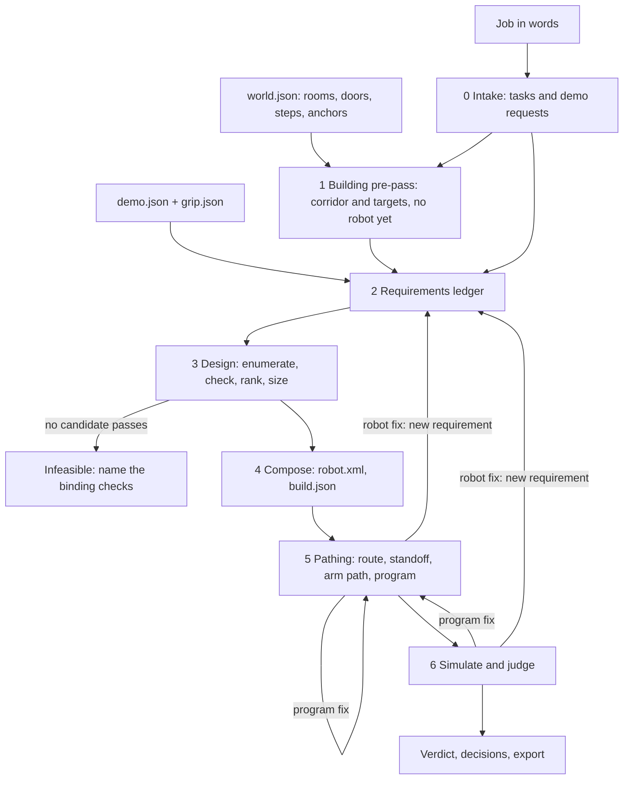

# The design and pathing workflows

Status: draft, 2026-11-14, by stream A's agent for the lead. It covers step 3 of the [flow](PLAN_REVISED.md#flow): how the robot is designed and how its route and motion are planned. File shapes belong to the schema work running in parallel. This doc lists the **fields each step needs**, not their schemas. Field names below are placeholders until then.

## Assumptions the lead can overrule

| # | Assumption | Why |
| :-- | :-- | :-- |
| A1 | **One robot per building, covering every job the user picked there.** Its requirements are the union of the jobs' requirements. | A landlord buys one robot per property, not one per chore. With one job picked, this is the same as one robot per job. |
| A2 | **The world frame is Matterport's: metres, Z up.** Capture and the Pathfinder scene package are +Y up. Each converts at its own boundary: `world.api.load` and `capture.api.latest` hand out Z-up data. | One frame in every run file. The only conversion is in stream C's code, which already knows both frames. |
| A3 | **Keep the 18-combination method:** enumerate, check, rank, then size. | Continuous part search was reviewed and [not adopted](PLAN_REVISED.md#suggestions-from-the-review-not-adopted). Sizing still tunes continuous values inside the chosen parts. |
| A4 | **Fixtures are anchors, found by the panorama agent or entered by hand and tagged `manual`.** Both workflows run the same way on either. | The API found 0 objects on 24 models. Without an anchor nothing can be reached. |

## The whole loop on one page



The two workflows are **design** (steps 2 to 4) and **pathing** (steps 1 and 5). Pathing runs twice: once before a robot exists, to state what the building demands, and once after, to plan for the robot's real footprint and reach. That breaks the circle in the [hand-off](PLAN_REVISED.md#how-the-two-workflows-hand-off): the passage the robot must fit through depends on the route, and the route depends on the robot.

## What comes in, and how far to trust it

| Source | What it gives the workflows | Label carried to the verdict |
| :-- | :-- | :-- |
| Job in words (user, via the LLM) | which jobs; the objects; the order; where to take things (the bin, the way out) | `user` |
| Matterport Model API, via `world.json` | rooms with width, depth and ceiling height; doorway widths and positions; hallway widths; floors; the mesh; the scan-position graph | `scan` |
| Fixture anchors in `world.json` | a pose for each target: point, surface normal, and an axis for things that turn (a bulb socket) | `scan:panorama-agent` or `manual` |
| Vexcel, CoStar | the way in from outside; which units; the owner | `scan` / `record`. Neither changes the robot in the first version. |
| `demo.json` (Quest) | the hand's path relative to the object, phases, the kind of motion and its numbers, approach direction, two-hand width | `demo:home` |
| `grip.json` (Quest + gloves) | the grip band and how it was measured: `source` is `glove` (newtons) or `travel` (trigger travel times a default 12 N per unit) | `demo:home`, plus `uncalibrated` while the source is `travel` |

Capture today keeps one wrist pose and one grip value per hand (`capture/README.md` on the `stream-c/pathfinder-quest` branch). The workflows must not depend on per-finger data. When the gloves add per-fingertip force, it improves two numbers (the force band and how many fingers held), and nothing else changes.

## Step 0. Intake: from words to tasks

**Model step.** The LLM turns the job into an ordered task list. Each task names a skill, an object, the anchor it acts on, and the demonstrations it needs.

| Skill | Built from | Demonstrations asked for |
| :-- | :-- | :-- |
| `twist_out`, `twist_in` (bulb) | the anchor's axis, the demo's twist | a path (`unscrew bulb`) and a squeeze (`hold bulb`) |
| `wipe` (surface) | the surface's extent in the building, the demo's stroke and passes | a path (`wipe table`); the press force comes from it |
| `pick`, `carry`, `place` (trash bag) | the bin anchor, the route out, the demo's lift and hold | a path (`lift trash bag`) and a squeeze (`hold trash bag`) |
| `navigate` | the route | none |

Intake keeps producing the shape of the website's stand-in planner (`world/pathfinder/backend/server/flow.py` on the stream C branch): `understood_as`, `steps[]` and `demos[{chore, kind, why}]`, so the site keeps working when the agent replaces the lookup table. It adds the task list for the steps after it.

Each demonstration request is a LangGraph `interrupt()`. The run resumes when `capture.api.latest(kind, chore=...)` has a recording. Recorded demonstrations stay on disk, so a resumed run never needs the headset.

## Step 1. Building pre-pass: what the building demands, before a robot exists

**Code step.** It reads only `world.json` and the task list.

1. **Clean the doorway widths.** Drop widths under 0.45 m or over 2.5 m as bad readings (the probe found near-zero values on two models). A room whose doorways are all missing or dropped gets its doorway widths from the mesh: slice it at 0.1 to 0.5 m above the floor and measure the gap in the wall-graph edge between the two rooms. That covers the 10 of 24 probed models with no doorways. A width found this way is labelled `scan:mesh`.
2. **Build the room graph.** Rooms are nodes. Each doorway or open boundary between two rooms is an edge whose weight is its clear width. Hallways are rooms whose own width also bounds the edge.
3. **Find the corridor for each trip.** The trips come from the task list: dock to each task's room, and for the trash bag, the bin to the way out. For each trip find the **widest-bottleneck path**: the path whose narrowest edge is as wide as possible (a maximin path; Dijkstra with `min` in place of `+`). Its narrowest edge is that trip's bottleneck. Doors off every corridor drop out; they do not constrain the robot.
4. **Read the vertical demands.** For each task's anchor: its height above the floor, the ceiling height in its room, and for the bulb, its axis. For each corridor: the tallest step or threshold, and whether it changes floor.

Out: the **building demands**, each with an id, a value, a unit and where it came from:

| Demand | From |
| :-- | :-- |
| narrowest passage on any corridor, and which door it is | step 3 |
| tallest step on any corridor; whether any corridor changes floor | step 4 |
| each anchor's pose, its height above the floor, and the ceiling over it | step 4 |
| the corridors themselves, as room sequences | step 3, for the second pathing pass to start from |

The Showcase SDK's scan-position graph with its A* is a quick cross-check on step 3: scan positions are places a tripod stood, so a route along them is known to be walkable. It is not the planner, because it knows nothing about the robot's size.

## Step 2. Requirements ledger: turning the building and the demo into numbers

**Code step, with the model choosing which rules apply.** Every requirement has an id, a quantity, a value, a unit, a tolerance and a source. Later steps read numbers only from the ledger.

The rule that matters: **a demonstration is filmed at home, so only what is relative to the object carries over. Everything about where the object is comes from the building.** `demo.reach.max_height_m` is the wearer's kitchen, not the landlord's ceiling, and with no scan under the marking ray the anchor is the wearer's own hand.

| Demo quantity | Carries over? | What the requirement uses instead |
| :-- | :-- | :-- |
| path relative to the object, phases | **yes** | re-anchored on the building's fixture pose (below) |
| approach direction | **yes** | rotated into the building by the fixture pose |
| twist axis, turns, angle | **yes** | the wrist must roll that many turns, or regrasp |
| hinge axis, radius, angle | **yes** | the arm must follow that arc |
| wipe stroke axis, passes | **yes** | the stroke and pass count |
| wipe patch size | no | the building's surface extent (counter or table in the scan); strokes are regenerated over it |
| carry distance | no | the route out, from the pre-pass |
| carry lift, two-hand width | **yes** | lift clearance over the bin rim; the gripper's opening |
| `reach.max_height_m`, `min_height_m`, `max_from_body_m` | **no** | heights come from the anchor in the building plus the re-anchored path |
| grip band | **yes, labelled `demo:home`** | the force check, gated on `grip.source` (below) |

**Re-anchoring.** The demo frame has its origin at the anchor, z out of the surface and x horizontal (`capture/process.py`, `anchor_frame`). The building's fixture gets the same frame by the same rule from its point and normal, with Z up. Then every demo pose maps into the building as `T_world_fixture · T_fixture_hand`. This is why an anchor needs a normal, and a bulb also needs an axis: a point alone gives no frame. When the panorama agent has only a point, the frame takes the room's ceiling or wall normal and is labelled `assumed-normal`.

Requirements that come out:

| Requirement | Computed as | Source |
| :-- | :-- | :-- |
| reach targets | every work-phase pose of the re-anchored path, plus the approach start | demo + scan |
| highest and lowest gripper height | from the reach targets, above the floor | demo + scan |
| base width ceiling | narrowest passage minus 2 × side margin (0.05 m each side) | scan |
| step limit | tallest step on any corridor | scan |
| floors | one floor, or the robot must climb | scan |
| gripper opening | object width plus margin; the two-hand width for the bag | demo, or the object card |
| payload | object mass from the object card (bulb 0.05 kg, bag up to 5 kg by default; the user can say) | user / card |
| force band | low end: the most of the demo's minimum and the physics minimum (hold the mass with friction μ = 0.5 and a safety factor of 1.5; for the bulb, pass the unscrew torque); high end: the demo's peak | demo:home + calculator |
| press force (wipe) | the grip or glove force during the work phase, or the user's number | demo:home |
| wrist roll | twist turns | demo |

The high end of the band is the person's peak, not the breaking force. A person's peak is a force that did not break the bulb; the breaking force is unknown. That is conservative.

## Step 3. Design: enumerate, check, rank, size

**Code step** in `composer.api.check(candidate, requirements)`. The model never overrides a failed check.

1. **Enumerate** the 18 candidates (2 bases × 3 reach × 3 grippers).
2. **Check** each one. Each check returns `pass`, `fail` or `not_assessable`, with the number behind it and the requirement ids it read.

| Check | Inputs | Fails when |
| :-- | :-- | :-- |
| Doorway | base width ceiling | the base's smallest width plus margin does not fit |
| Steps | step limit | the tallest step is above the base's limit |
| Floors | floors | the corridor changes floor and the base cannot climb |
| Reach | reach targets, the reach part's range | inverse kinematics finds no pose at some target from any base pose the base's footprint allows near it |
| Tip-over | payload, reach out from the base, base width | the arm and payload's moment about the support edge, times a safety factor of 1.5, exceeds the base's restoring moment |
| Opening | gripper opening | the gripper does not open that wide |
| Force | force band, `grip.source` | the gripper cannot hold a force inside the band, or cannot sense it finer than a quarter of the band's width |
| Twist | wrist roll | the wrist cannot roll that far and no regrasp is planned |

   **The Force check is `not_assessable` while `grip.source` is `travel`.** An uncalibrated band can be replayed on the same glove but cannot size a gripper. A `not_assessable` check does not reject a candidate. It is shown as such in the decision record and the verdict, and the design is labelled "force not verified".

3. **Rank** the survivors by cost: a weighted sum of actuator count, mass and part price, weights in a config file.
4. **Size** the winner. Each sized value is the smallest that passes every check with margin. Most are independent: lift travel from the highest target, slider extension from the farthest one, gripper stroke from the opening. **Base width is the one that is bound from both sides,** and is worked through below.
5. **Record** one decision per slot in `decisions.jsonl`, with every option it beat and a `revisit_if`.

If no candidate passes, the design step stops and reports **the binding checks**: the checks that failed on the candidate that failed fewest, with the numbers. For example, regression scenario S6: "no feasible design: Reach fails on every candidate; the bulb is at 3.50 m and the tallest lift reaches 2.40 m."

### Worked example: the base width window

The doorway check sets a ceiling on base width. Tip-over sets a floor, because a wider base resists more when the arm reaches out to the side. The design is feasible only when the floor is under the ceiling.

Base of width `w` and mass `M`, payload `m_p` held `r` out from the base's centre, arm of mass `m_a` with its centre of mass `r_a` out, safety factor `SF`. Tip-over about the side edge passes when

```
M · w/2  ≥  SF · [ m_p · (r − w/2) + m_a · (r_a − w/2) ]
w  ≥  2 · SF · (m_p · r + m_a · r_a) / (M + SF · (m_p + m_a))
```

Illustrative numbers for the trash bag: `M` = 20 kg, `m_p` = 5 kg at `r` = 0.6 m, `m_a` = 2 kg at `r_a` = 0.35 m, `SF` = 1.5:

- tip-over floor: `w ≥ 2 · 1.5 · (3.0 + 0.7) / (20 + 10.5)` = **0.36 m**
- doorway ceiling in a 0.54 m doorway: 0.54 − 2 × 0.05 = **0.44 m**
- window: 0.36 to 0.44 m. Size to the floor plus margin.

If the bag is carried at `r` = 0.25 m (arm retracted) instead, the floor drops to about 0.19 m. That is a **program fix**: the pathing step can carry the bag tucked in, and the robot does not change. The loop below tries program fixes before robot fixes.

## Step 4. Compose

`composer.api.compose(design)` writes `robot.xml` and `build.json`. Pathing needs from `build.json`: the base footprint polygon and its inscribed and circumscribed radii, the base's step limit, the reach envelope (the gripper's reachable heights and distances from the base, as a table), the joint limits, and the kinematic chain for IK.

## Step 5. Pathing: route, standoff, arm path, program

This is the second pathing pass, now with a robot.

### 5a. Standoff poses

For each task, where the base parks so the arm can do the work.

1. **Sample** base poses (x, y, heading) on rings around the anchor's floor projection: radii from 0.2 m to the reach envelope's maximum, every 0.05 m and every 15°.
2. **Reject** poses where the footprint hits the occupancy grid, or that are not connected to the dock.
3. **Check reach:** inverse kinematics on every reach target of that task's re-anchored path (`motion` stream, with mink).
4. **Check tip-over** at that pose with the arm at its farthest target.
5. **Score** the rest: manipulability at the targets (higher is better), clearance to obstacles, and distance along the route. Keep the best and two spares.

### 5b. Base route

1. **Occupancy grid:** slice the mesh between 0.05 m above the floor and the robot's height, project down, at 0.05 m cells.
2. **Inflate** by the footprint's inscribed radius and plan with A* on the grid. Seed it with the pre-pass corridors, so it searches only those rooms.
3. **Check the footprint along the path,** with heading: a rectangular base that fits a door may not fit the turn into it. Where the polygon collides, mark that spot; a turn needs the circumscribed radius free.
4. **Carrying changes the footprint.** For the trash bag, the leg from the bin to the way out uses the footprint with the bag held (the arm's carry pose plus the bag's size). This is where a carry pose gets tucked in.
5. Route order: dock → each task's standoff in the task list's order → for the bag, the way out → dock.

Out: base waypoints, the standoff pose per task, and the clearance at each door on the route.

### 5c. Arm path

`motion.api.retarget(demo, robot)` maps each task's re-anchored hand path to joint space:

- **twist:** grasp at the socket, then roll the wrist about the anchor's axis by the demo's turns. If the wrist's roll limit is shorter, split it into grasp, roll, release, roll back, regrasp.
- **wipe:** generate strokes along the demo's stroke axis over the building's surface extent, with the demo's pass count, holding the press force normal to the surface.
- **pick and carry:** the demo's approach direction and lift, then the carry pose from 5b.
- Every segment is checked against joint limits and for collision with the mesh.

### 5d. Program

The **model** writes `program.json` from the task list, the route and the arm paths: ordered primitives with parameters (move base, lift, follow path, grasp with a force band, twist, wipe, retreat, place). Each primitive cites the requirements it serves.

## Step 6. Simulate and judge

`sim.api.run(run_dir)` runs the program in MuJoCo on the mesh. The run checks: the task's outcome (the bulb turned out and in; the patch covered; the bag reached the way out), pad force inside the band throughout, no unplanned contact, no tip. The verdict keeps the source labels: a force inside the band is "inside the band measured at home", never a fact about the building.

## When something fails: the loop

A failure becomes a **new constraint** that cites the check that produced it. Constraints are only ever added. The loop tries the cheapest fix first.

| Failure | Program fix (robot unchanged) | Robot fix (new requirement, back to step 2) |
| :-- | :-- | :-- |
| no collision-free route through a door | another heading through it; a three-point turn | base width ≤ the measured clear width minus margin |
| no standoff reaches every target | a spare standoff; split the task over two standoffs | reach ≥ the shortfall at that height |
| tip-over at the standoff | tuck the arm or the payload in; park closer | base width ≥ the tip-over floor, or more base mass |
| wrist roll too short | regrasp | wrist roll ≥ the turns |
| pad force left the band in sim | slower approach; a lower force setpoint | finer force sensing, or another gripper |
| object slipped in sim | a higher setpoint inside the band | the force band's low end goes up |

**It stops.** Each pass adds at least one constraint, so the candidates that pass can only shrink. The loop also stops after 5 robot fixes. On stopping without a pass, it reports the binding checks, as in step 3.

A decision's `revisit_if` is tested on every pass. When a new constraint matches it, that decision is reopened and shown as a backtrack in the trace.

## Who does each step

| Step | Code or model | Stream | Entry point |
| :-- | :-- | :-- | :-- |
| 0 Intake | model | A | agent node |
| 1 Building pre-pass | code | A (reads `world.json`) | agent node; see request R1 |
| 2 Requirements | code; model picks the rules | A | agent node |
| 3 Design | code | B | `composer.api.check` |
| 4 Compose | code | B | `composer.api.compose` |
| 5a Standoff | code | C proposes poses, B checks IK | see request R2 |
| 5b Route | code | C | `nav.api.plan(world, build)` |
| 5c Arm path | code | B | `motion.api.retarget(demo, robot)` |
| 5d Program | model | A | agent node |
| 6 Simulate | code | B | `sim.api.run(run_dir)` |
| Loop: diagnose and choose the fix | model; the fix is checked by code | A | agent node |

## Requests for the schema chat and the board

These follow from the steps above. None is a contract change yet; each is posted on the board with B and C tagged before it becomes one.

| # | Request | Why |
| :-- | :-- | :-- |
| R1 | `world.json` carries the room graph: which doorway joins which two rooms, its clear width and how it was measured (`api`, `mesh`, `dropped`), the step height at each doorway, the floor of each room, and the dock and the way out | the pre-pass runs on `world.json` alone, before any robot, so nothing needs a new entry point |
| R2 | `nav.api.plan` needs the tasks (which anchors, in which order, and which legs carry something), which `(world, build)` does not hold. Either it reads them from `program.json`'s draft or `requirements.json` in the run folder, or the signature becomes `plan(world, build, tasks)` | the route visits standoffs, and the standoffs depend on the tasks |
| R3 | each anchor in `world.json` has a point, a normal, an axis where it turns, the surface extent where it is wiped, and a source label (`panorama-agent` or `manual`) | re-anchoring needs a frame, not a point |
| R4 | `build.json` carries the footprint polygon, its inscribed and circumscribed radii, the step limit and the reach envelope as a table | pathing plans for the real footprint and reach |
| R5 | each check result in `composer.api.check` is `pass`, `fail` or `not_assessable`, with its number and the requirement ids it read | the Force gate; the binding-check report |
| R6 | `demo.json` and `grip.json` are Z up, or say their frame | A2 |

## Still open

- Object cards: masses and sizes for the bulb, the bag and the cloth. A small file the user can edit, or numbers the model asks for at intake.
- Whether the panorama agent exists by hour 16. If not, every anchor is `manual`, entered in the headset or the web view.
- The friction coefficient and the bulb's unscrew torque in the physics minimum are assumed. They should be labelled `assumed` in the ledger until someone measures one.
- Whether the margin values (0.05 m a side, safety factor 1.5) go in the same config file as the cost weights.
